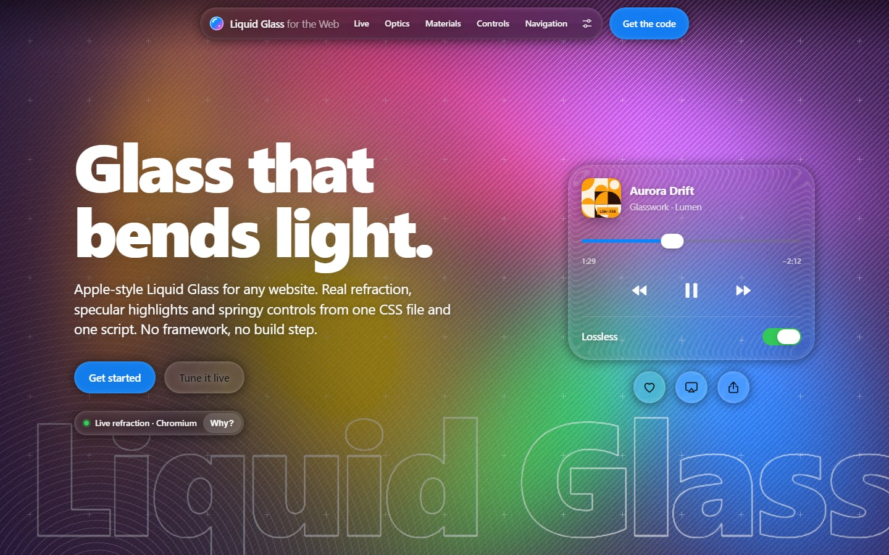

# Liquid Glass for the Web

Apple-style Liquid Glass for any website: real refraction, specular highlights and springy controls from one CSS
file and one script. No framework, no build step, no dependencies.

**Live demo: [batch-ly.com/glass](https://batch-ly.com/glass/)**



## Get started

Add the stylesheet and the script, then put `.glass` on anything.

```html
<!-- in <head> -->
<link rel="stylesheet" href="liquid-glass.css">
<script src="liquid-glass.js" defer></script>

<!-- anywhere in <body> -->
<nav class="glass glass-bar">…</nav>
<button class="glass glass-button glass-prominent" data-glass-interactive>Buy</button>
<label class="glass-switch"><input type="checkbox" role="switch"> Wi-Fi</label>
<glass-lens size="140" zoom="1.5"></glass-lens>
```

The CSS alone gives frosted glass in every modern browser. The script adds refraction, highlights that follow each
shape, adaptive tone and the controls.

Using ES modules? Keep `liquid-glass.mjs` next to `liquid-glass.js`:

```js
import LiquidGlass from './liquid-glass.mjs';
```

## What your browser renders

The bend is an SVG displacement filter inside `backdrop-filter`.

| Browser | What you get |
|---|---|
| Chrome, Edge and other Chromium browsers (version 120 or later) | Live refraction: the rim bends and magnifies whatever is behind the glass |
| Safari, Firefox, and every browser on iPhone and iPad | The frosted tier: live blur, highlights, shadow and motion, without the bend |
| Reduce Transparency, Increase Contrast, forced colours, print | A solid, legible surface |

Neither tier is a screenshot. The glass always shows the live page behind it. Reduce Motion is respected too.

## What is in the box

| Piece | Markup |
|---|---|
| Glass | `.glass` on any element. `data-glass="clear"` for the clear material, `data-glass-tint="#5e5ce6"` for tinted, `data-glass-optics="bevel"` for thick glass |
| Buttons | `.glass.glass-button`, with `.glass-prominent`, `.glass-icon`, `data-glass-size="small"` or `"large"`, and `data-glass-interactive` for the press effect |
| Bars and groups | `.glass.glass-bar`, `.glass.glass-group` holding `.glass-item`s, inside a `.glass-toolbar` |
| Tab bar | `.glass.glass-tabbar` with `<a>` or `<button>` tabs; hold a tab and drag to scrub. `data-glass-minimize="scroll"` tucks it away while the page scrolls |
| Segmented control | `.glass.glass-segmented` with `<label><input type="radio"><span>…</span></label>` segments. `data-glass-segments="content"` sizes them by their labels |
| Switch | `<label class="glass-switch"><input type="checkbox" role="switch"> …</label>` |
| Slider | `<div class="glass-slider"><input type="range"></div>` |
| Search field | `<search class="glass glass-search">` holding an `<input type="search">` |
| Sheet | `<dialog class="glass glass-sheet">` with detents |
| Menu | `<div popover class="glass glass-menu" role="menu">` that springs out of its invoker |
| Scroll edge | `.glass-scroll-edge`, which blurs and fades content under a floating bar |
| Magnifier | `<glass-lens size zoom dispersion>` |
| Droplet merge (experimental) | `.glass-container`: shapes fuse when they get close |

Every control is a native input underneath (real buttons, checkboxes, radios, ranges and dialogs), so keyboards,
forms and screen readers keep working.

`index.html` is the showcase and uses all of it; read it next to the page for working examples. The **Tune**
panel on the demo changes the library's settings live.

## JavaScript

The script defines `LiquidGlass` (also the default export of `liquid-glass.mjs`) with `version`, `init`,
`register`, `attach`, `get`, `update`, `refresh`, `destroy`, `setPreferences`, `spring`, `stats`, `capabilities`,
`defaults`, `events` and `extend`. Glass and controls found in the page are set up automatically when it loads,
and elements added later are picked up. To start it yourself, set `window.LiquidGlassConfig = { autoInit: false }`
before the script and call `LiquidGlass.init()`.

## New in 1.2.0: thick glass

The showcase now opens with a new preset, **thick**: every glass is a solid slab with a round edge instead of a thin
sheet. What passes under it bends and magnifies toward the rim, like looking through a glass rod; the rim catches
the light and a tight shadow sits under it.

```html
<!-- every glass on the page -->
<html data-glass-preset="thick">

<!-- or one element: the bezel is the radius of the slab's round edge, in px -->
<div class="glass" data-glass-optics="bevel" data-glass-bezel="30">…</div>
```

The look follows [liquid-glass.ybouane.com](https://liquid-glass.ybouane.com/), which paints a snapshot of the page
through a WebGL shader. Here it is live refraction, like the rest of the library, so it follows scrolling and every
change on the page. The iOS 26 and iOS 27 presets are unchanged and still in the Tune panel. See
[CHANGELOG.md](CHANGELOG.md) for how it works and where it lives in the bundle.

## In 1.1.0: the pill resizes

- `data-glass-segments="content"` on a segmented control sizes each segment by its label instead of equally.
- While you scrub a tab bar or a segmented control, the lifted lens takes the width of the item under it and eases
  there, so it always covers exactly the item a release would pick.

```html
<div class="glass glass-segmented" role="radiogroup" aria-label="Shelf" data-glass-segments="content">
  <label><input type="radio" name="shelf" value="all" checked><span>All</span></label>
  <label><input type="radio" name="shelf" value="fav"><span>Favorites</span></label>
  <label><input type="radio" name="shelf" value="new"><span>Recently Added</span></label>
</div>
```

See [CHANGELOG.md](CHANGELOG.md) for how it works and where it lives in the bundle.

## Files

| File | Role |
|---|---|
| `liquid-glass.css` | The library's styles |
| `liquid-glass.js` | The library (unminified, with the name of each source partial marked) |
| `liquid-glass.mjs` | ES-module wrapper around `liquid-glass.js` |
| `index.html`, `showcase/` | The showcase page: its styles, procedural background art, behaviour and tuning panel |

Nothing here makes a network request, loads a web font or touches browser storage.

## License

[MIT](LICENSE). An independent, Apple-inspired implementation. Not affiliated with Apple.
